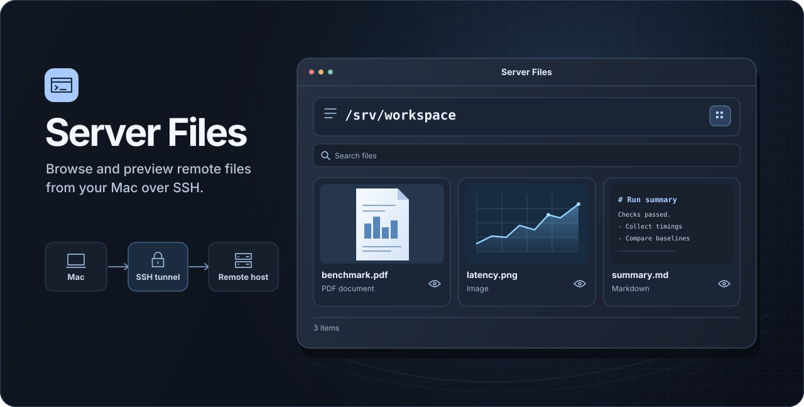

# Server Files



Browse, preview, and manage files on an SSH server from macOS or Windows. Open the workspace in your browser and refresh to see the latest files.

Server Files runs independently of Codex. The release packages include the launcher and remote preview worker. Sign in with your existing SSH account. You do not need Python on your Mac or Windows PC.

[繁體中文快速開始](#繁體中文快速開始) · [Architecture and trust boundaries](docs/architecture.md)

## Download 1.2.0

| Platform | Download |
| --- | --- |
| macOS 13 or later, Apple silicon and Intel | [macOS Universal ZIP](../../releases/download/v1.2.0/Server-Files-1.2.0-macOS-universal.zip) |
| Windows 10 22H2 or Windows 11, x64 | [Windows x64 ZIP](../../releases/download/v1.2.0/Server-Files-1.2.0-Windows-x64.zip) |
| Windows 11, ARM64 | [Windows ARM64 ZIP](../../releases/download/v1.2.0/Server-Files-1.2.0-Windows-arm64.zip) |

[SHA256SUMS](../../releases/download/v1.2.0/SHA256SUMS) · [All releases](../../releases)

The server needs a Unix environment with **Python 3.10+** and OpenSSH that permits local forwarding to Unix sockets. Poppler’s `pdftoppm` is optional for PDF cover previews.

## Quick start

### macOS

1. Extract the ZIP and open **Server Files.app**. The app is ad hoc signed. If Gatekeeper blocks it, verify the source and checksum, then follow Apple’s instructions for approving this specific app. [Apple Support](https://support.apple.com/en-us/102445)
2. Enter your SSH host, username, port, and optional remote folder. Leave the password field blank when using an SSH key. Password storage in macOS Keychain is optional.
3. Connect. Use the menu bar app to switch or stop connections.

### Windows

1. Run `ssh -V` in PowerShell. If Windows cannot find the command, install **OpenSSH Client** from Windows Optional Features. [Microsoft Learn](https://learn.microsoft.com/en-us/windows-server/administration/openssh/openssh_install_firstuse?pivots=windows-11&tabs=gui)
2. Extract the ZIP for your architecture and double-click **ServerFiles.exe**. The ZIP contains a single executable that runs as a console app. The executable is unsigned; check the source and checksum if Windows shows a first-run warning.
3. Enter your SSH host, username, port, and optional remote folder. The username defaults to your Windows sign-in name and the port to `22`. OpenSSH uses your existing keys or prompts in the console for authentication.
4. Keep the console open while using the browser. Press **Ctrl+C** to disconnect.

### Connection and previews

If SSH asks you to trust a new host, compare the fingerprint with one from the server administrator before accepting it. Leave the remote folder blank to browse your SSH account’s home directory. To scope both browser views to a specific folder, enter an existing absolute path such as `/srv/workspace` or a home-relative path such as `~/reports`.

While connected, open **Files** at [127.0.0.1:8878](http://127.0.0.1:8878/) to manage files or **Reports** at [127.0.0.1:8877](http://127.0.0.1:8877/) for read-only previews.

### Verify a download

Compare the SHA-256 hash of your ZIP with its entry in the release’s [SHA256SUMS](../../releases/download/v1.2.0/SHA256SUMS). From the download folder, use the command for your platform and substitute your ZIP’s filename as needed.

```sh
shasum -a 256 Server-Files-1.2.0-macOS-universal.zip
```

```powershell
Get-FileHash -Algorithm SHA256 .\Server-Files-1.2.0-Windows-x64.zip
```

## What you can do

- Browse in icon, list, or column view. Sort by modification date, size, or kind and mark files with red, green, or blue tags.
- Search filenames and paths recursively. Enable content search to scan eligible UTF-8 text files within the current folder and its subfolders. Each scan reads files up to 2 MiB, with a budget of 4,096 candidate files, 50,000 directory entries, or 64 MiB of text and a display limit of 200 results.
- Open supported PDFs, images, and text files by clicking the file row or thumbnail. Resize the preview or editor to fit your screen. JSON previews and editing use syntax highlighting. Icon view loads image and text covers as they enter view. Poppler can provide a PDF first-page cover.
- Use the folder breadcrumbs to jump to a parent folder. Check remaining capacity and low-space notices. If the server reports an account quota, the card shows it. Otherwise the card shows the shared file system.
- Upload files and folders with byte and percentage progress. Download files or ZIP archives, copy remote paths, and create, rename, or move files. Edit `.py`, `.md`, `.txt`, and `.json` files or move files to a recoverable server-side trash folder.
- Reopen up to six recently opened files. Use the gear menu to show or hide the recent files panel and the panel’s **Clear** button to remove its history.
- Switch the web interface between light and dark themes. Choose English, 繁體中文, 简体中文, 日本語, or 한국어.

## Build from source

For macOS, install the Xcode Command Line Tools and run the build script from the repository root.

```sh
./scripts/build.sh
```

To cross-build the Windows ZIPs, install Go 1.21+ and Python 3.10+ on macOS or Linux, then run `./scripts/build-windows.sh`. For a full release, run the macOS build first and then the Windows build so `dist/SHA256SUMS` includes all three ZIPs.

Run the server tests with `python3 -m unittest discover -s tests` and the launcher tests with `./scripts/build-windows.sh --test`.

## 繁體中文快速開始

Server Files 可在 macOS 和 Windows 透過 SSH 瀏覽、預覽及管理伺服器檔案。發行包已包含啟動器和預覽程式，可獨立於 Codex 使用，直接用既有的 SSH 帳號登入。伺服器需要 Unix 環境及 **Python 3.10 以上**，OpenSSH 須允許 Unix socket 轉送。若要顯示 PDF 首頁封面，可在伺服器安裝 Poppler 的 `pdftoppm`。

- **macOS 13 以上**（Apple 晶片或 Intel）請下載通用版 ZIP，解壓縮並開啟 **Server Files.app**。如遇 Gatekeeper 阻擋，先確認來源與雜湊值，再依 Apple 說明對此 App 個別核准。[下載 macOS](../../releases/download/v1.2.0/Server-Files-1.2.0-macOS-universal.zip) · [Apple 支援](https://support.apple.com/en-us/102445)
- **Windows 10 22H2 或 Windows 11** 請下載對應架構，解壓縮並雙擊 **ServerFiles.exe**。ARM64 版適用 Windows 11。若 PowerShell 找不到 `ssh -V`，可從 Windows 的選用功能安裝 **OpenSSH Client**。[下載 x64](../../releases/download/v1.2.0/Server-Files-1.2.0-Windows-x64.zip) · [下載 ARM64](../../releases/download/v1.2.0/Server-Files-1.2.0-Windows-arm64.zip) · [Microsoft 安裝說明](https://learn.microsoft.com/en-us/windows-server/administration/openssh/openssh_install_firstuse?pivots=windows-11&tabs=gui)

1. 輸入 SSH 主機、帳號、連接埠（預設 `22`）及遠端資料夾。Mac 使用金鑰時可將密碼留空，儲存到鑰匙圈為選填。Windows 由 OpenSSH 使用金鑰或在主控台詢問登入資訊。首次連線若出現主機指紋，先向伺服器管理員核對。
2. 遠端資料夾留空會開啟 SSH 帳號的主目錄。填入 `/srv/workspace` 或 `~/reports` 這類既有路徑，可將兩個頁面限制在該資料夾。
3. 連線後，在 [127.0.0.1:8878](http://127.0.0.1:8878/) 管理檔案，在 [127.0.0.1:8877](http://127.0.0.1:8877/) 預覽報告。Windows 使用時請保持主控台開啟，按 **Ctrl+C** 斷線。Mac 從選單列切換或中斷連線。

可用 macOS 的 `shasum -a 256` 或 Windows PowerShell 的 `Get-FileHash -Algorithm SHA256` 計算 ZIP 的雜湊值，再比對同名檔案的發行紀錄。[SHA256SUMS](../../releases/download/v1.2.0/SHA256SUMS)
